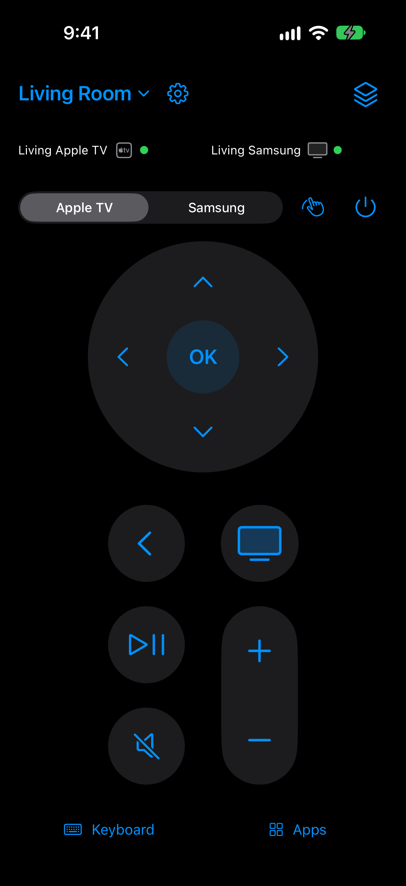
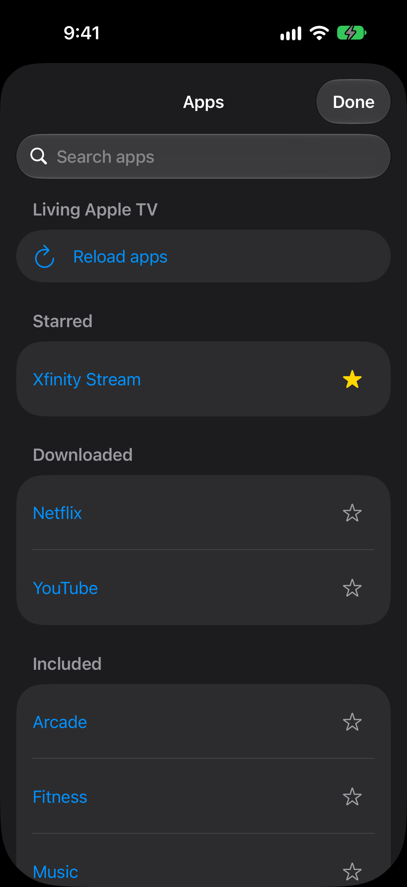
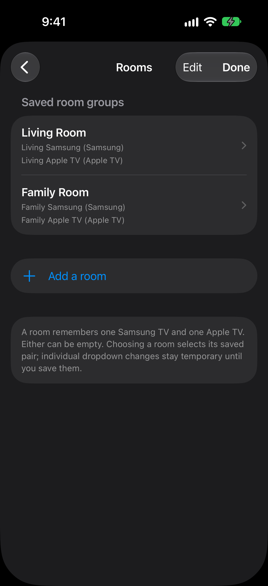
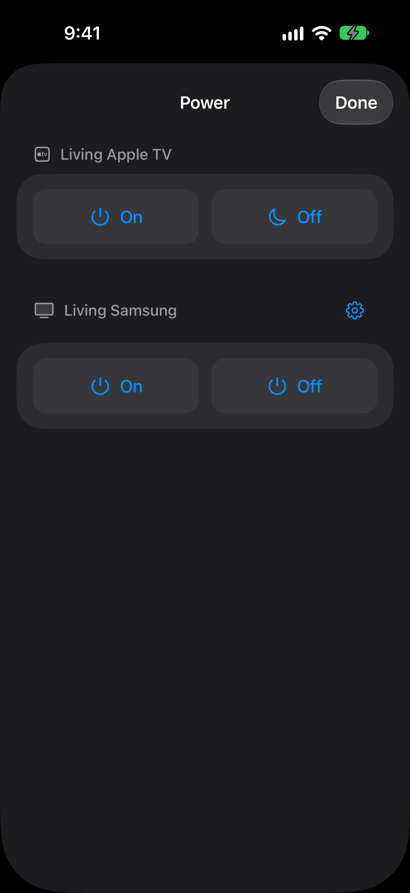
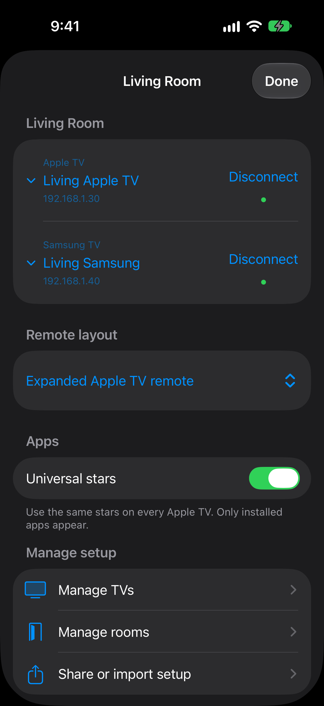

<p align="center">
  
</p>

<h1 align="center">ATV Remote</h1>

An iPhone remote for Apple TV and Samsung TVs. It talks to your TVs directly
over your home Wi-Fi, with no cloud account, relay server or always-on computer,
and groups them into rooms so one tap switches the whole remote to the TVs in
the room you're in.

ATV Remote is an independent project and is not affiliated with Apple or
Samsung.

<p align="center">
  
  
  
  
  
</p>

## Features

- **One remote for both TVs.** A connection bar shows the room's Apple TV and
  Samsung TV side by side; navigation goes to whichever you pick.
- **Rooms.** Save a Samsung TV and an Apple TV (either can be empty) as a room,
  then switch rooms from the menu at the top.
- **Remote layouts.** Choose an Apple TV–style layout or an alternate one, with
  a D-pad or a swipe touchpad.
- **Apple TV**
  - Navigation, Back, Home, Play/Pause; double-tap Home for the app switcher
    and hold it for Control Center
  - Type into text fields with the iPhone keyboard
  - Browse installed apps, launch them and star favorites
  - Wake and sleep
- **Samsung TV**
  - Navigation, volume, mute and the input/source menu
  - Turn on over the network (Wake-on-LAN) and power off
  - Scan the TV's IP and MAC address with the camera instead of typing them
- **Shortcuts.** Restart a stuck Apple TV app, including a one-tap Restart
  Xfinity Stream.
- **Share setup.** Send your rooms, TVs and starred apps to another iPhone with
  AirDrop or Files, optionally protected by a four-word phrase. Each phone
  pairs with the TVs itself.

## Requirements

- iPhone with iOS 27 or later, on the same network as the TVs
- Apple TV (any model that shows a pairing code for remote apps)
- Samsung Tizen TV that offers the secure remote connection on port 8002
- Xcode 27 to build

## Build and install

There is no App Store release. Build it yourself and install it with your own
Apple developer account (Xcode or TestFlight) or a sideloading tool.

1. Create `App/Signing.local.xcconfig` with your team and a bundle ID. The file
   is ignored by git.

   ```
   DEVELOPMENT_TEAM = ABCDE12345
   PRODUCT_BUNDLE_IDENTIFIER = com.example.atvremote
   ```

   Without it the bundle ID defaults to `io.github.atvremote` and Xcode asks
   you to choose a team.

2. Generate the Xcode project and open it:

   ```sh
   python3 scripts/generate-project.py
   open App/RoomRemote.xcodeproj
   ```

3. Run on your iPhone, or use **Product → Archive** to upload to TestFlight.

To build an unsigned IPA for a sideloading tool instead, run
`python3 scripts/build-ipa.py`; it is written to `Build/`.

All dependencies are vendored in `Vendor/`, so no package downloads are needed.

## First setup

1. Open the settings gear → **Manage TVs**.
2. **Apple TV:** pick it from the discovered list and enter the four-digit code
   shown on the TV.
3. **Samsung:** enter a name and the TV's IP address (or scan it), confirm the
   TV's certificate, then accept the access prompt on the TV. To turn the TV on
   from the app, add its MAC address and enable *Power On with Mobile* in the
   TV's network settings.
4. Allow **Local Network** access when iOS asks.

See [docs/install-and-test.md](docs/install-and-test.md) for the full
walkthrough and [docs/share-pairings.md](docs/share-pairings.md) for sharing
setup between phones.

## How it works

| Device | Protocol |
| --- | --- |
| Apple TV | Companion protocol, found with Bonjour and paired with the on-screen PIN, using [SwiftATV](Vendor/SwiftATV), a Swift port of [pyatv](https://github.com/postlund/pyatv) |
| Samsung TV | Tizen remote WebSocket over TLS (port 8002), with the TV's certificate pinned after you confirm it |
| Samsung power on | A Wake-on-LAN packet sent to the TV's saved MAC address on the local network |
| Address scanning | Apple's on-device text recognition (VisionKit); no photos are saved |

Pairing keys and Samsung tokens are stored in the iPhone's Keychain and never
leave the phone, including when you share your setup.

## Project layout

```
App/Sources     SwiftUI app and TV drivers
App/Tests       Unit tests
App/UITests     UI tests
Vendor/         SwiftATV, SwiftNIO, swift-protobuf, BigInt and other dependencies
scripts/        Project generation and IPA build scripts
docs/           Setup guides, design notes and source audits
design/         App icon sources and an interactive design preview
```

## Acknowledgements

Apple TV support builds on [SwiftATV](Vendor/SwiftATV) (MIT) and
[pyatv](https://github.com/postlund/pyatv). Each vendored package keeps its own
license in `Vendor/`, and third-party notices ship with the app in
`App/Resources/ThirdPartyNotices.txt`.

## License

MIT. See [LICENSE](LICENSE).
